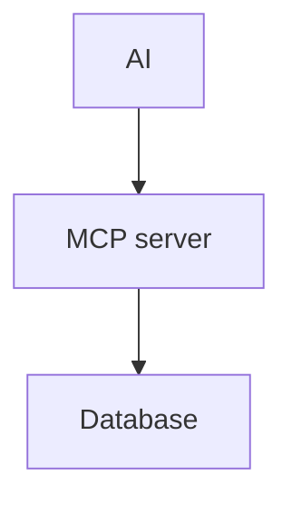
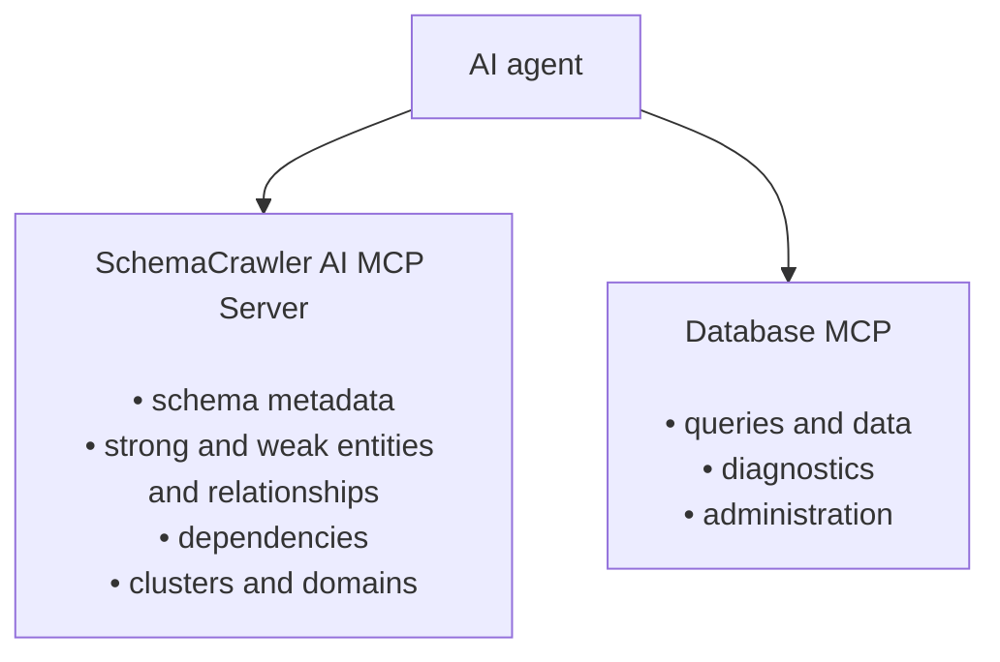

# Stop Giving Your AI Blind Access to Databases

Most of the excitement around database MCP servers centers on one idea:

> “Now my AI can run SQL against my database.”

That is useful—but running queries is only part of working with a database. In a large or unfamiliar schema, the harder task is understanding what the database represents and how its objects depend on one another.

Why does `CUSTOMER_STATUS_CD` exist? What does the `XREF` prefix mean? Which procedures use this table? What might break if a column changes?

These are questions about metadata and structure, not just query results. This is where the **SchemaCrawler AI MCP Server** can help.

> See [schemacrawler/SchemaCrawler-AI-MCP-Server-Usage](https://github.com/schemacrawler/SchemaCrawler-AI-MCP-Server-Usage) for the usage guide.

## Querying data is not the same as understanding a schema

Many database MCP servers focus on connecting an AI to a database so it can execute SQL, retrieve data, and inspect tables and columns:

That works well for questions such as:

> Show me the customers created in the last 30 days.

But a request like “Explain the design of this database” needs more context. A list of tables and columns may not reveal how the objects fit together or which parts of the system rely on them.

A database contains more than rows and tables. Its metadata can include:

- Relationships and foreign keys
- Views, triggers, procedures, and functions
- Constraints and indexes
- Dependencies between database objects
- Naming conventions and domain models

People often start with this structure when learning a database. AI assistants need it, too.

## What SchemaCrawler AI MCP Server adds

SchemaCrawler is a schema discovery and documentation tool. Its MCP server makes that schema information available to AI workflows, including table definitions, relationships, ER-model structure, routines, triggers, DDL, and dependency information. It uses graph theory to build clusters and infer design domains.

For example, when asked about an `Orders` table, an assistant can use more than its columns and sample rows. It can examine related entities, foreign keys, and database objects that depend on the table. That broader context can support a more informed explanation.

**SchemaCrawler AI MCP Server** is especially useful for questions such as:

- What objects depend on this table or column?
- How are these customer and account entities related?
- Which procedures or views might be affected by a change?
- What does this schema reveal about the application’s data model?

It can help the AI reason about the database’s structure; it cannot, by itself, prove the original intent behind every design choice.

## Two complementary kinds of database work

Database questions often fall into two broad groups:

| Question | Best suited to |
|---|---|
| “How many orders were created yesterday?” | A database MCP server that can query data |
| “Find customers in California.” | A database MCP server that can query data |
| “How are customers and accounts related?” | **SchemaCrawler AI MCP Server**’s schema metadata |
| “Which objects may be affected by this change?” | **SchemaCrawler AI MCP Server**’s dependency information |

The capabilities of database MCP servers vary. **SchemaCrawler AI MCP Server** is not intended to replace a database-specific server that executes queries or retrieves live data. The two can work together:

Use schema metadata to understand the database; use a database MCP server to perform the operations it supports. Together, they can give an AI assistant context as well as access to data.

## Where schema understanding helps

### Legacy modernization

In older systems, documentation may be missing and business rules may live in stored procedures. **SchemaCrawler AI MCP Server** can help identify relationships and dependencies to investigate before changing a table or column.

### Developer onboarding

When a new developer asks how a business concept is represented, the assistant can inspect the schema before offering an explanation. That is more grounded than guessing from names alone.

### Architecture reviews

Questions about repeated entities, central tables, or relationships are questions about the model—not simply about the data in it. Schema metadata gives the assistant a useful starting point for that analysis.

### Migration planning

Moving between database platforms or to the cloud requires understanding relationships and dependencies, not just transferring rows. Richer metadata can help surface what a migration team should examine.

## An example: changing a customer status

Suppose an assistant is asked to add a customer status and update the application. A query-focused database MCP server may help locate and modify the relevant data. **SchemaCrawler AI MCP Server** can add context by helping identify procedures, triggers, views, and relationships that may also be affected.

That is the difference between helping with a database operation and helping understand the potential impact of a change.

## The takeaway

The database MCP server ecosystem often emphasizes query execution because it is easy to demonstrate. But in many projects, the bigger challenge is understanding what the database means and how its parts fit together.

Use a database-specific MCP when the assistant needs to query or operate on data. Use **SchemaCrawler AI MCP Server** when it needs to explore schema structure and dependencies. Use both when the assistant needs both kinds of context.

> See [schemacrawler/SchemaCrawler-AI-MCP-Server-Usage](https://github.com/schemacrawler/SchemaCrawler-AI-MCP-Server-Usage) for the usage guide.
